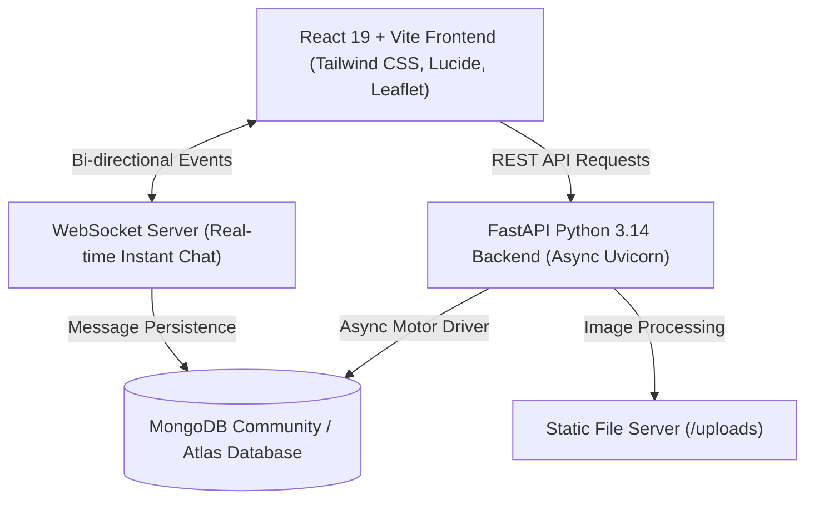

# My House 🏠
> **Modern PG, Flat & Roommate Discovery Platform with Smart Lifestyle Compatibility Matching Across 13 Indian Metropolitan Cities**

[](https://fastapi.tiangolo.com)
[](https://react.dev)
[](https://vitejs.dev)
[](https://www.mongodb.com)
[](https://tailwindcss.com)
[](https://opensource.org/licenses/MIT)

---

## 📖 Overview

**My House** is a production-grade, full-stack web platform built for students and working professionals across India to find verified **Paying Guest (PG) accommodations, private rented rooms, studios (1RK), apartments (1BHK, 2BHK, 3BHK, 4BHK)**, and **compatible flatmates**.

Featuring **Zero Brokerage Direct Host Connection**, an interactive **Google Maps & Satellite GIS engine**, an automated **Lifestyle Compatibility Radar (0–100%)**, real-time **WebSocket chat**, **profile photo uploads**, and **live GPS transit navigation**.

---

## 🌟 Key Highlights & Features

### 1. 🏙️ 13 Indian Metropolitan Hubs
Complete locality data, coordinates, tech parks, and landmark hubs:
* **Maharashtra**: Pune (*Baner, Hinjawadi, Kothrud*), Mumbai (*Bandra, Andheri, Powai, Juhu, Thane*)
* **Karnataka**: Bengaluru (*Koramangala, Indiranagar, HSR Layout, Whitefield, Electronic City*)
* **Delhi NCR**: New Delhi, Gurugram Cyber City, Noida Sector 62, Hauz Khas, Saket
* **Telangana**: Hyderabad (*HITEC City, Gachibowli, Madhapur, Kondapur*)
* **Tamil Nadu**: Chennai (*Adyar, OMR IT Corridor, Velachery, Anna Nagar*)
* **West Bengal**: Kolkata (*Salt Lake Sector V, New Town, Park Street, Ballygunge*)
* **Rajasthan**: Jaipur (*Malviya Nagar WTP, Mansarovar, Vaishali Nagar, C-Scheme*)
* **Kerala**: Kochi (*Kakkanad Infopark, Marine Drive, Edappally LuLu Mall*)
* **Gujarat**: Ahmedabad (*SG Highway, Prahlad Nagar, Bodakdev*)
* **Punjab & Haryana**: Chandigarh (*Sector 17, Sector 35, Mohali Phase 7*)
* **Madhya Pradesh**: Indore (*Vijay Nagar, Palasia, Super Corridor*)
* **Uttar Pradesh**: Lucknow (*Gomti Nagar, Hazratganj, Aliganj*)

### 2. 🗺️ Interactive Maps & Location Engine
* **Multiple Map Layers**: Switch seamlessly between **Google Streets**, **Google Satellite**, **Google Terrain**, and OpenStreetMap.
* **Host Pin Location Picker**: Draggable coordinate picker with live reverse-geocoding into city and neighborhood addresses.
* **Commute Radar**: Instant walking, driving, and transit travel time estimations using the Haversine distance formula.
* **1-Click Google Directions**: Instant route guidance directly on Google Maps from current GPS location.

### 3. 🤝 Roommate Compatibility Matching Algorithm (0–100%)
* **50 Pts — Lifestyle Habits**: Cleanliness level (1–5 scale), sleep schedules (Early Bird vs. Night Owl), food preferences (Veg/Non-Veg/Vegan), smoking/drinking policies, guest allowance, pet tolerance, and Work-From-Home (WFH) schedules.
* **20 Pts — City & Locality Proximity**: Proximity scoring between users' preferred neighborhood circles.
* **15 Pts — Budget Overlap**: Overlapping rent bracket calculations.
* **15 Pts — Gender Preference Alignment**: Strict matching respecting user preference constraints.

### 4. 📸 Profile Photo Management (Hosters & Seekers)
* **Direct Image Upload**: Drag-and-drop or browse JPG, PNG, WEBP files up to 10MB.
* **Curated Presets**: 12 pre-styled professional personas tailored for hosts, students, and corporate flatmates.
* **Web Image URL**: Paste any direct HTTPS image link with live preview.
* **Real-time Propagation**: Profile image updates immediately sync across the navigation bar, active chats, posted listings, and roommate requirement cards.

### 5. 🔍 Robust Search & Filters
* **Accommodation Types**: PG, Private Room, 1RK Studio, 1BHK, 2BHK, 3BHK, 4BHK, Shared room.
* **Filters**: Budget range slider, gender preference, furnishing status, verified hosts only, 24+ amenities tags.
* **Sort Modes**: Newest first, rent low-to-high, rent high-to-low, resident ratings, and "Nearest to Me" GPS sort.
* **View Modes**: Interactive Grid, Compact List, and Fullscreen Interactive Map View.

### 6. 💬 Live WebSocket Chat & Visit Scheduling
* **Real-Time Messaging**: Direct tenant-to-host chat with online/offline indicators, typing notifications, and photo sharing.
* **Schedule Visits**: In-app physical/virtual visit booking with date & time slots and host accept/decline actions.
* **Wishlist**: 1-click property save with immediate sync to Seeker Dashboard.
* **Reviews & Ratings**: Verified resident star ratings and feedback.

### 7. 🎨 UI & Design Architecture
* **Theme System**: High-contrast Day and Night Mode with persistent localStorage memory.
* **Logo & Aesthetics**: Animated glowing house brand mark with Electric Rose (`#e11d48`) and Royal Indigo (`#4f46e5`) accents.
* **Multi-Language Support**: English (`en`) and regional Indian languages powered by `react-i18next`.

---

## 🏗️ Architecture & Tech Stack



### Technology Breakdown
* **Backend**: Python 3.14 / 3.11+, FastAPI, Motor (Async MongoDB), Pydantic v2, PyJWT, Passlib, Bcrypt, WebSockets, Aiofiles.
* **Frontend**: React 19, Vite 8, Tailwind CSS, Lucide React, Leaflet & React-Leaflet, Recharts, React Hot Toast, i18next.
* **Database**: MongoDB (Local or Atlas) with geospatial indexing (`2dsphere`).

---

## ⚡ Quick Start Guide

### Prerequisites
* [Node.js](https://nodejs.org) (v18+)
* [Python](https://python.org) (v3.11+)
* [MongoDB](https://www.mongodb.com/try/download/community) running locally on port `27017`

---

### Step 1: Clone Repository
```bash
git clone https://github.com/your-username/my-house.git
cd my-house
```

---

### Step 2: Backend Setup
```bash
cd backend

# Create and activate Python virtual environment
python -m venv venv

# Windows:
.\venv\Scripts\activate
# macOS / Linux:
# source venv/bin/activate

# Install dependencies
pip install -r requirements.txt

# Create .env from template
copy .env.example .env   # Windows
# cp .env.example .env    # macOS/Linux

# (Optional) Seed database with demo accounts, listings across all 13 cities:
python seed.py

# Run API Server
uvicorn app.main:app --reload --host 127.0.0.1 --port 8000
```
> **Backend API:** `http://127.0.0.1:8000`  
> **Interactive Swagger Docs:** `http://127.0.0.1:8000/docs`

---

### Step 3: Frontend Setup
Open a new terminal window in the project root:
```bash
cd frontend

# Install dependencies
npm install

# Create .env from template
copy .env.example .env   # Windows
# cp .env.example .env    # macOS/Linux

# Start Vite Development Server
npm run dev
```
> **Web Application:** `http://localhost:5173`

---

### One-Click Launchers (Windows)
Double-click `run.bat` or run `powershell -File run.ps1` in the project root to automatically launch both backend and frontend servers in separate terminal windows.

---

## 🧪 Demo Credentials

The seed script creates the following pre-configured test accounts:

| Role | Email / Mobile | Password | Access & Purpose |
| :--- | :--- | :--- | :--- |
| **Property Host / Lister** | `owner@myhouse.com` or `9822011223` | `Owner@12345` | Manages active listings, accepts visit slots, views analytics |
| **Room Seeker** | `seeker@myhouse.com` or `9765433221` | `Seeker@12345` | Searches homes, saves wishlist, matches flatmates, chats |
| **Admin Moderator** | `admin@myhouse.com` | `Admin@12345` | Accesses `/admin` panel, user & property moderation |

> **OTP Verification Demo Code:** When testing mobile OTP or phone verification, enter code `123456`.

---

## 📋 API Overview

| Method | Endpoint | Description |
| :--- | :--- | :--- |
| `POST` | `/api/v1/auth/login` | Email/Phone + password or quick OTP login |
| `POST` | `/api/v1/auth/register` | Register new Seeker or Property Host |
| `GET` | `/api/v1/listings` | Paginated search with city, rent, BHK type, & geo filters |
| `POST` | `/api/v1/listings` | Publish new accommodation listing with Google coordinates |
| `GET` | `/api/v1/roommates` | Browse roommate requirements with compatibility sorting |
| `POST` | `/api/v1/roommates` | Post roommate requirement with lifestyle questionnaire |
| `POST` | `/api/v1/uploads/avatar` | Upload and propagate user profile photo |
| `POST` | `/api/v1/favorites/{id}` | Toggle property wishlist state |
| `POST` | `/api/v1/visits` | Request a physical or virtual visit slot |
| `WS` | `/api/v1/chat/ws` | Bi-directional real-time WebSocket messaging |

---

## 🧪 Running Automated Tests

```bash
cd backend
.\venv\Scripts\activate
pytest -v tests
```

---

## 🛡️ License

This project is open-source under the [MIT License](LICENSE).
